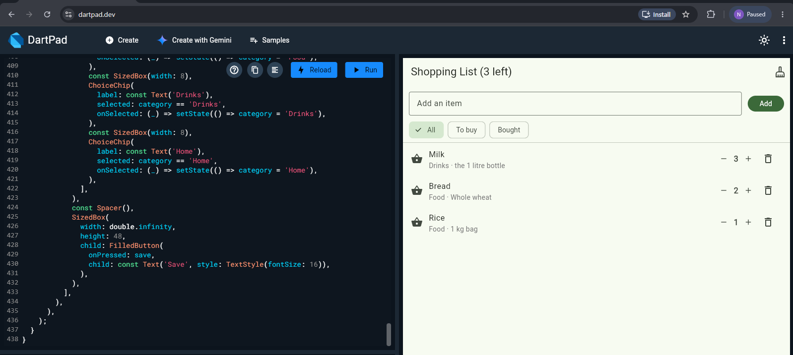
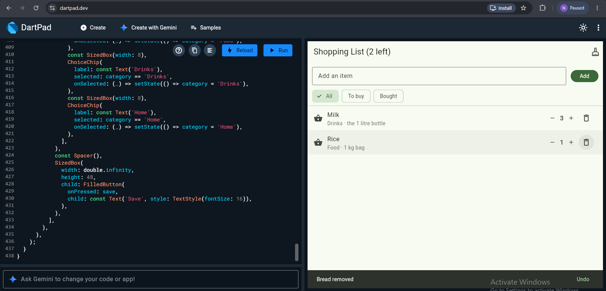
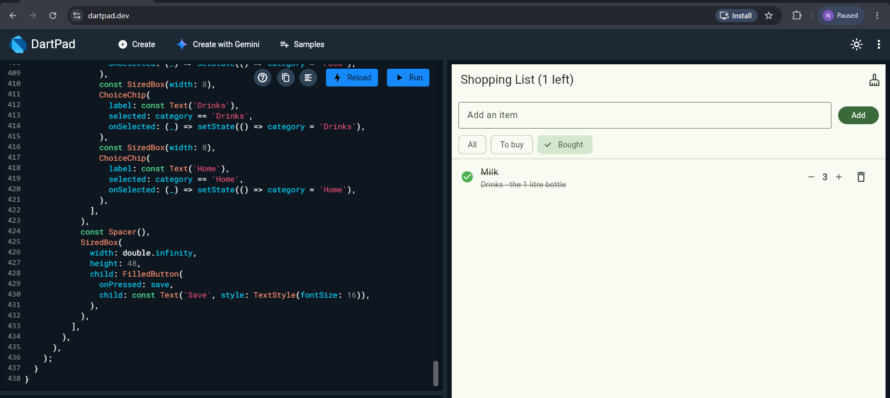
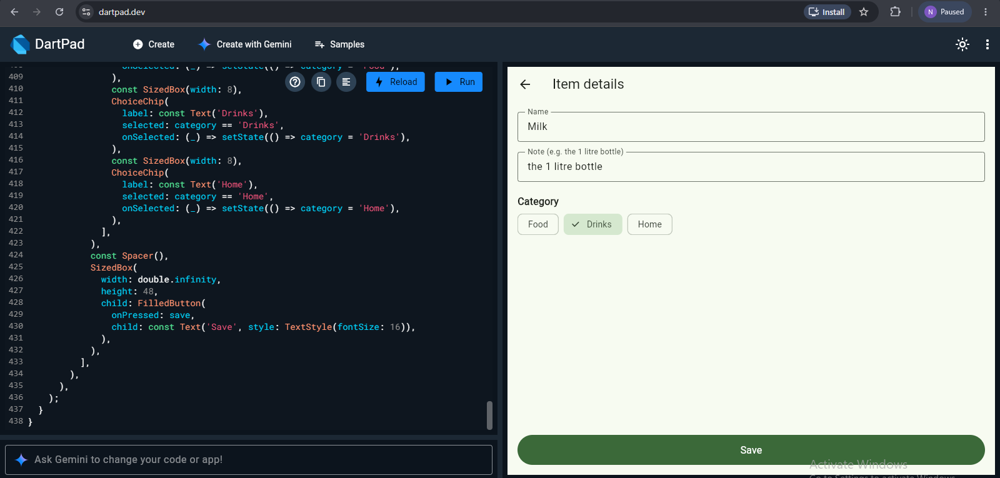
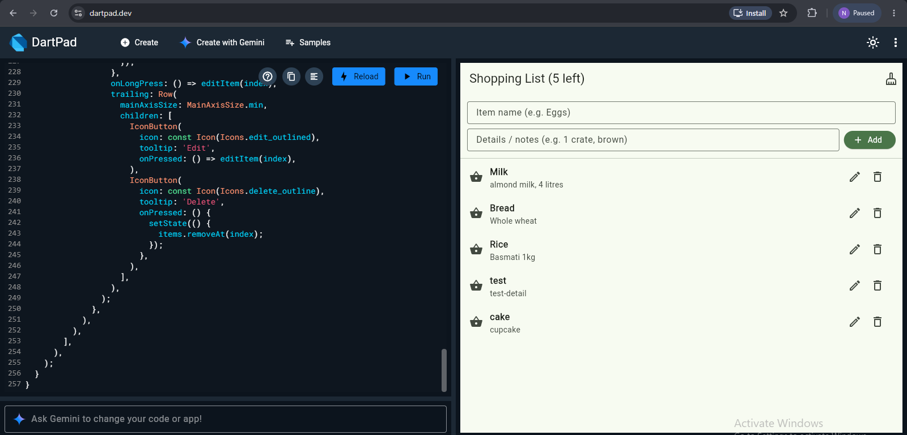
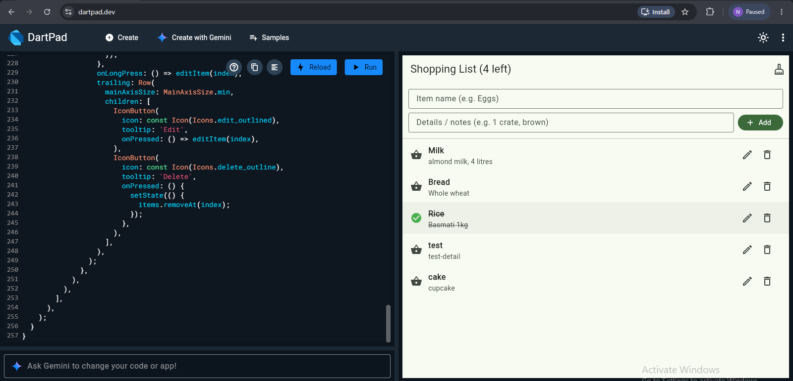
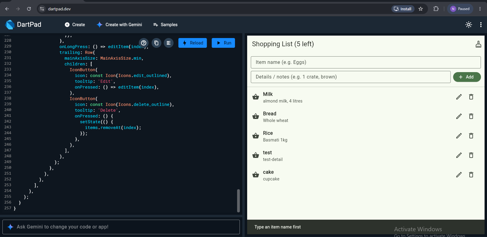

# Shopping List+

My first Flutter app: an interactive shopping list featuring quantities, duplicate prevention, undo support, filter chips, and an item details screen.

## Features (Shopping List+ Upgrades)
- **Empty State**: Displays "Your list is empty" when no items exist, rather than a blank page.
- **Quantity Controls**: Adjust item quantities with `−` and `+` buttons without allowing quantities below 1.
- **Smart Duplicate Prevention**: Case-insensitive and trimmed checking (`milk` matches `MILK`); increments existing item quantity and notifies the user with a message.
- **Undo Delete**: Restores deleted items to their exact previous position, preserving status and quantity via an Undo SnackBar action.
- **Category & Filter Chips**: Switch views between **All** (bought items sorted to bottom), **To buy**, and **Bought**, with empty state handling.
- **Item Details Screen**: Long-press any item to navigate to a dedicated editing screen to update Name, Note, and Category (**Food**, **Drinks**, **Home**).

## Screenshots

### Shopping List+ Upgrades

### Core App Screenshots

## Think Answers

### 1. In part 5, why does deleting by `index` remove the wrong item when a filter is on? How did you fix it?
When a filter is active (such as "To buy" or "Bought"), the `ListView.builder` displays rows from a filtered subset (`shown`), not the master `items` list. The row `index` on the screen matches the item's index in `shown`, which often does not match its index in `items` (e.g., the 1st bought item might be item #4 in the full list). Deleting `items[index]` therefore removes the wrong item.  
**Fix:** We pass the actual `Item` object reference to `deleteItem(item)` and look up its true index in the master list (`items.indexOf(item)`) or remove it by reference (`items.remove(item)`).

### 2. Why did you have to remove `final` from `name`? Why is `final` still a good choice for most fields?
`final` fields in Dart are immutable and can only be set once during initialization. Because Part 6 requires editing the item's name on the details screen, `item.name` had to be mutable (`item.name = newName`), so `final` had to be removed.  
`final` is still the best practice for most fields because immutability prevents accidental mutations, eliminates subtle side-effects, and allows Flutter to safely reuse widgets and perform performance optimizations (e.g. `const` widgets).

### 3. Why did you need a hot restart after adding `quantity` to `Item`, when a save was enough for everything else?
Hot reload injects updated code into the Dart VM while preserving the active memory state of the app. The existing objects in memory were allocated under the older class definition without a `quantity` field. Hot reload cannot migrate existing heap objects to a new schema. A hot restart restarts the app from `main()`, rebuilding all state and initializing the items with the new `Item` blueprint.

### 4. The details screen changed the item, but the list only showed it after `setState` in `.then`. Why? What does this tell you about how Flutter decides when to redraw?
Although the `DetailsScreen` modified the `item` reference in memory, `HomeScreen` had no way of knowing the object's properties had changed. Flutter does not monitor or poll object fields for changes automatically. Calling `setState(() {})` inside the `.then(...)` callback explicitly marks `HomeScreen` as dirty, scheduling a call to its `build` method. This shows that Flutter uses a reactive, explicit model: the UI only redraws when code explicitly signals state changes via `setState`.
